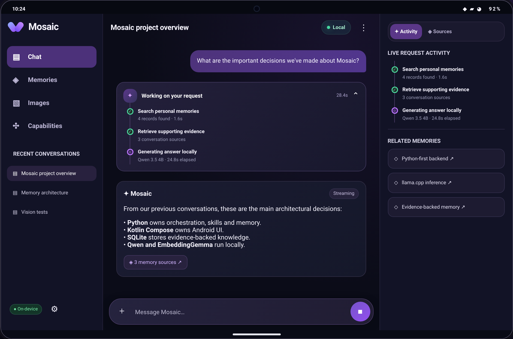
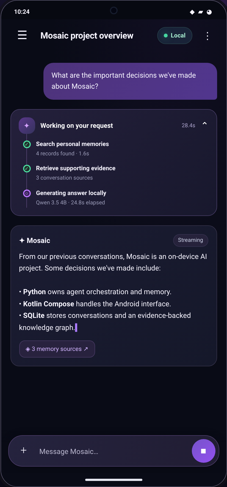
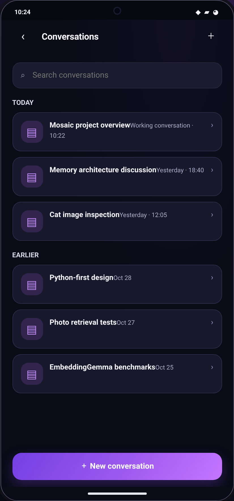

# Mosaic

<p align="center">
  <strong>A private, local-first intelligence workspace for Android.</strong><br />
  Built around on-device Qwen, multimodal retrieval, evidence-backed memory, and a Python-owned agent.
</p>

<p align="center">
  
</p>
<p align="center">
  
  
</p>

Mosaic brings a complete local intelligence stack to Android: Kotlin renders a responsive Fold-aware interface; Chaquopy hosts the application logic in Python; and llama.cpp runs Qwen and EmbeddingGemma directly on the device.

```text
Kotlin + Jetpack Compose → Chaquopy → Python → JNI → llama.cpp
                                  ↘ SQLite
```

## What Mosaic does

### Local Qwen chat, with real streaming

Qwen 3.5 4B runs through llama.cpp on the phone, with OpenCL GPU offload on the Galaxy Z Fold 6 and a CPU fallback. Final-answer tokens stream into the Compose chat interface, with lifecycle-safe cancellation and clear agent activity states.

### Image understanding and visual retrieval

Qwen accepts an image plus a question through its matching multimodal projector. EmbeddingGemma 2 creates real text and image vectors for semantic image retrieval, and the Images workspace lets people deliberately add, browse, and search their local index.

### Evidence-backed personal memory

Python owns a portable SQLite ledger for conversations, messages, sources, and float32 embeddings. On top of that ledger, Mosaic builds a knowledge graph of entities and claims with correction history and provenance back to the exact source message or available text span.

### An agent that uses tools safely

Qwen decides whether to answer directly or call an allow-listed Python tool. The current tool set covers memory search, image search, web search, and webpage retrieval. Tool requests are strictly validated; the model never receives arbitrary Python, shell, or filesystem access.

### Current web research, local reasoning

When configured by the user, DeepSeek Search & Fetch supplies web search results and page content. Qwen remains entirely local: DeepSeek is used only for retrieval, and final reasoning and answer generation stay on-device. Search queries and fetched URLs are disclosed before use and API keys stay in Android-backed secure settings.

### Designed for the Fold

Mosaic adapts from a compact cover-screen workspace with edge-swipe navigation to a persistent navigation rail and contextual panel on the unfolded display. Conversations, drafts, requests, and model state survive layout changes.

## Built on a local-native stack

| Layer | Role |
| --- | --- |
| Kotlin + Jetpack Compose | Fold-aware UI, lifecycle, file pickers, streaming state, and secure settings. |
| Python 3.11 via Chaquopy | Conversation logic, agent orchestration, tools, skills, memory, retrieval, and SQLite persistence. |
| llama.cpp + JNI | Qwen generation and vision, EmbeddingGemma text/image embeddings, native model lifecycle, and GPU/CPU execution. |
| SQLite | Durable conversations, tool events, image sources, vector blobs, skills, claims, and provenance. |

## Verified on the Galaxy Z Fold 6

- Qwen generation follows the complete Kotlin → Python → JNI → llama.cpp → Python → Kotlin path, with all 33 Qwen layers offloaded through OpenCL.
- Qwen has answered questions about actual cat and car pixels via the Qwen multimodal projector.
- EmbeddingGemma produced normalized 768-dimensional text and image vectors, and semantic retrieval ranked cat, car, and banana images correctly.
- Image vectors, conversations, assistant answers, knowledge claims, and evidence survived an application restart.
- Qwen autonomously called `search_images` and `search_memories`; Python validated the payloads, retrieved real local data, and Qwen used those results in its final response.

For metrics, test details, model configuration, and the native implementation, see the [technical guide](docs/TECHNICAL.md).

## Clone the repository

This repository uses Git submodules for llama.cpp and native header dependencies. Clone recursively:

```bash
git clone --recurse-submodules https://github.com/randomMatrix77/mosaic.git
cd mosaic
```

If you already cloned it without submodules, initialize them before building:

```bash
git submodule update --init --recursive
```

The checked-in submodules are:

- [`llama.cpp`](https://github.com/ggml-org/llama.cpp), the native inference runtime.
- [`OpenCL-Headers`](https://github.com/KhronosGroup/OpenCL-Headers), used by the selected Android GPU backend.
- [`Vulkan-Headers`](https://github.com/KhronosGroup/Vulkan-Headers), retained as a native dependency for experimentation; Vulkan is not the active Qwen backend.

Model weights are intentionally not in Git or the APK. Obtain them separately and comply with their respective licences and terms:

- [Qwen 3.5 4B Q4_K_M GGUF](https://huggingface.co/unsloth/Qwen3.5-4B-GGUF/resolve/main/Qwen3.5-4B-Q4_K_M.gguf)
- [Qwen 3.5 4B multimodal projector (`mmproj-F16.gguf`)](https://huggingface.co/unsloth/Qwen3.5-4B-GGUF/resolve/main/mmproj-F16.gguf) — required for Qwen image input; this exact file is distinct from EmbeddingGemma's projector.
- [EmbeddingGemma 2 GGUF repository](https://huggingface.co/ggml-org/embeddinggemma-2-GGUF) — import both the embedding GGUF and its matching `mmproj` file for image embeddings.

## Requirements

The currently tested development environment is macOS with Java 17, Android SDK API 36, Android NDK `27.2.12479018`, and CMake `3.22.1`. A physical Android device with USB debugging is recommended; the implementation was verified on a Samsung Galaxy Z Fold 6 (`SM-F956B`).

There is one additional native prerequisite for the current OpenCL configuration: the project links against an Android-device-compatible `libOpenCL.so` stub in `app/src/main/cpp/prebuilt/arm64-v8a/`. That binary is intentionally ignored by Git because it is device/vendor specific. Read the [technical guide](docs/TECHNICAL.md#opencl-gpu-linkage) before attempting a fresh GPU build on another phone.

## Build, install, and run

From the repository root:

```bash
./gradlew :app:assembleDebug
adb devices
adb install -r app/build/outputs/apk/debug/app-debug.apk
```

`adb install -r` updates the app without clearing its data. Do not uninstall or clear app data if you want to retain imported models, conversations, and the SQLite database.

On first launch:

1. Use the Qwen import action to select the downloaded Qwen GGUF.
2. Wait for model loading, then create a conversation and send a message.
3. To run embedding diagnostics, import the EmbeddingGemma GGUF and matching multimodal projector (`mmproj`) using the corresponding file-picker actions.

The app copies selected model files into its private storage; it does not bundle multi-gigabyte weights in the APK.

## Architecture at a glance

The Android app is intentionally single-module and compact. Kotlin handles UI, lifecycle, file selection, and native bindings. Python owns message handling, bounded conversation-history preparation, persistence, embedding interfaces, retrieval calculations, and errors. llama.cpp owns actual model loading and inference.

The model lifecycle manager keeps the active runtime explicit, restores imported Qwen weights at startup, and coordinates Qwen with EmbeddingGemma for generation and retrieval work.

For debug commands, component layout, data formats, model settings, test evidence, and troubleshooting, read the [technical guide](docs/TECHNICAL.md).

## Project map

```text
app/
  src/main/java/       Kotlin Compose UI and JNI bridge
  src/main/python/     Mosaic application, inference, embeddings, and storage
  src/main/cpp/        Native bridge, CMake, llama.cpp and header submodules
docs/                  Implementation and operational documentation
```

## Join the build

Mosaic is actively evolving as an Android-first, private intelligence workspace. Keep model weights out of Git, preserve local app data while testing, and use the technical guide to reproduce the verified native stack.
